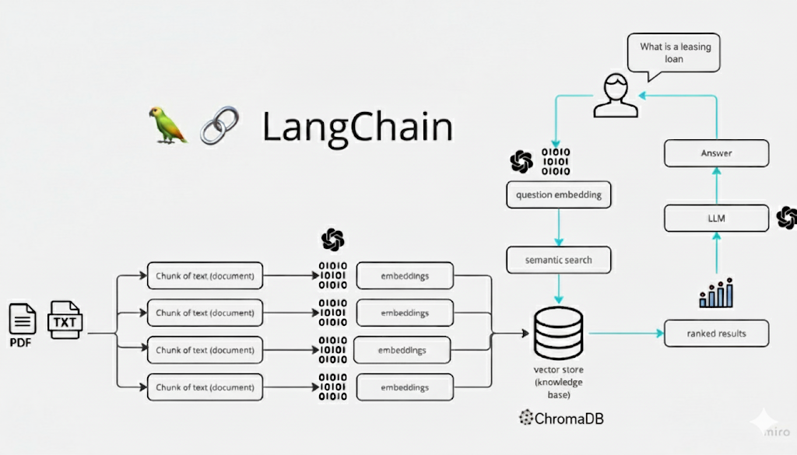
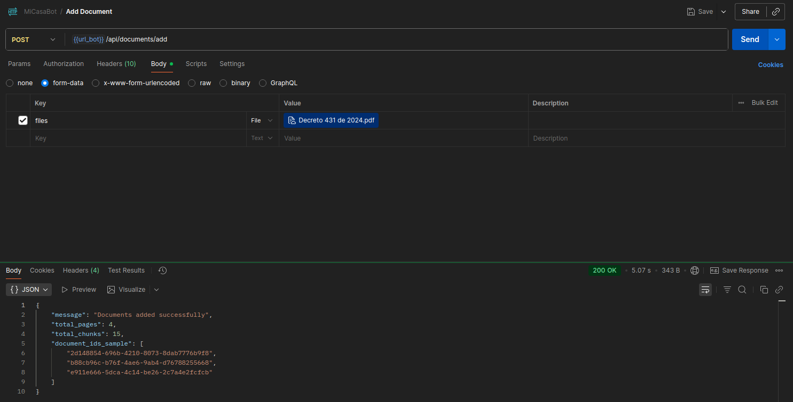
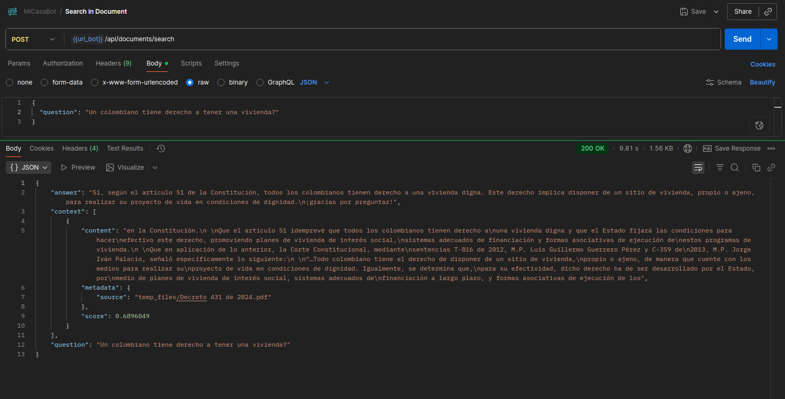

# Data Science and Machine Learning Vault

The required *Python* version for this project is *3.12.x.*

## About me

Hello, my name is *Oscar*, I am 26 years old, and I am from Bogotá, Colombia. My experience in the world of software development is what I acquired during my time at university. This degree has been quite challenging for me because I also work at Airbnb in customer service, which is why I speak Portuguese and have an intermediate level of English. The reason I chose this career is because I love automating processes and really enjoy analyzing data on a small scale. I'm not the best at math, but I believe that with practice and study, anything is possible.

## Project Description

**MiCasaBot** is a sophisticated chatbot designed to provide answers to questions related to home acquisition in Colombia. It helps users understand various concepts, clarifies rights and procedures, and guides them through the process of acquiring a home using a curated knowledge base.

## How It Is Built?

**MiCasaBot** utilizes several advanced technologies:

* **LangChain + Chroma**: Integrates the language model (LLM) with the Chroma vector database for efficient semantic search.
* **Embeddings (Hugging Face `sentence-transformers/all-MiniLM-L6-v2`)**: Converts text into vector representations for similarity search.
* **Gemini-2.5-Flash Model**: Provides the processing power for natural language understanding and response generation.
* **Directive-based prompt pattern**: Guides the language model to generate appropriate responses based on query context and user interaction directives.

## Architecture Overview


## Setup environment

As usual setup your virtual environment:

```
$ python -m venv venv
$ source venv/bin/activate
$ pip install --upgrade pip setuptools
$ pip install -r requirements-dev.txt
$ pip install -e .
```

## Basic code compliance

```
$ black .
All done! ✨ 🍰 ✨
X files left unchanged.
$ mypy .
Success: no issues found in X source files
```

## About the CI/CD pipeline

This `monorepo` comes with a pre-configured CI/CD pipeline that is triggered every time a push is made to a **merge request** or when a **merge request** is integrated into the **main** branch.

The pipeline is configured to:

- Execute **code compliance** checks.
- Generate documentation.

> You may add more stages or jobs to the pipeline, but make sure you **do not remove the existing ones**. In addition, make sure you do your best to **keep the pipeline green** at all times.

## Running the Backend

This project uses Docker Compose to run the backend service along with a **Chroma** container for vector storage. Make sure you have **Docker** and **Docker Compose** installed.

To start the backend, run:

```bash
# Using the modern docker compose
$ docker compose up -d

# Or with
$ docker-compose up -d
```

This command will:

* Build the backend Docker image (if not built already).
* Start the backend service.
* Start the Chroma container for vector storage.

## Enpoints

**Base URL:** `http://localhost:8001`

| Method | Endpoint                | Description                             | Request Body                                                                                           |
| ------ | ---------------------- | --------------------------------------- | ------------------------------------------------------------------------------------------------------ |
| POST   | `/api/documents/add`    | Add a new document to the database       | `{ "file": "src/app/data/Decreto 431 de 2024.pdf" }`                                                   |
| POST   | `/api/documents/search` | Search for answers in the document database | `{ "question": "Un colombiano tiene derecho a tener una vivienda?" }`                                  |

**Example Usage:**



