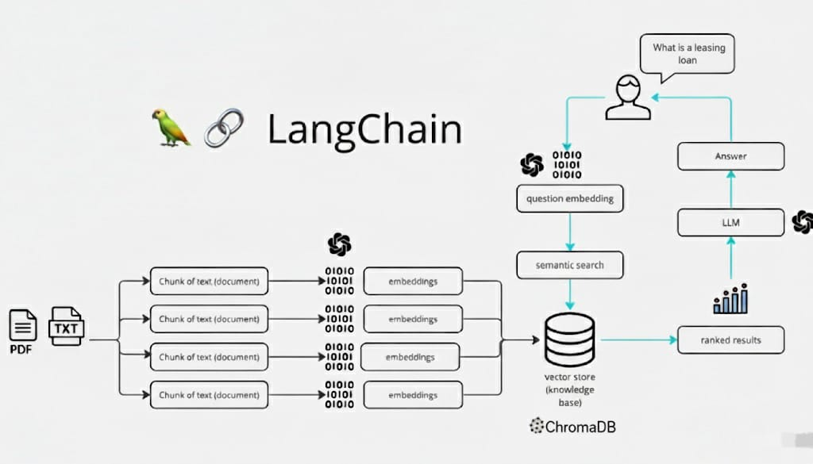

# Data Science and Machine Learning Vault

The required *Python* version for this project is *3.12.x.*

## About me

Hello, my name is *Oscar*, I am 26 years old, and I am from Bogotá, Colombia. My experience in the world of software development is what I acquired during my time at university. This degree has been quite challenging for me because I also work at Airbnb in customer service, which is why I speak Portuguese and have an intermediate level of English. The reason I chose this career is because I love automating processes and really enjoy analyzing data on a small scale. I'm not the best at math, but I believe that with practice and study, anything is possible.

## Project Description

**MiCasaBot** is a sophisticated chatbot designed to provide answers to questions related to home acquisition in Colombia. It helps users understand various concepts, clarifies rights and procedures, and guides them through the process of acquiring a home using a curated knowledge base.

## How It Is Built?

**MiCasaBot** utilizes several advanced technologies:

* **LangChain + Chroma**: Integrates the language model (LLM) with the Chroma vector database for efficient semantic search.
* **Embeddings (Hugging Face `sentence-transformers/all-MiniLM-L6-v2`)**: Converts text into vector representations for similarity search.
* **Gemini-2.5-Flash Model**: Provides the processing power for natural language understanding and response generation.
* **Directive-based prompt pattern**: Guides the language model to generate appropriate responses based on query context and user interaction directives.

## Architecture Overview


## Setup environment

As usual setup your virtual environment:

```
$ python -m venv venv
$ source venv/bin/activate
$ pip install --upgrade pip setuptools
$ pip install -r requirements-dev.txt
$ pip install -e .
```

## Basic code compliance

```
$ black .
All done! ✨ 🍰 ✨
X files left unchanged.
$ mypy .
Success: no issues found in X source files
```

## About the CI/CD pipeline

This `monorepo` comes with a pre-configured CI/CD pipeline that is triggered every time a push is made to a **merge request** or when a **merge request** is integrated into the **main** branch.

The pipeline is configured to:

- Execute **code compliance** checks.
- Generate documentation.

> You may add more stages or jobs to the pipeline, but make sure you **do not remove the existing ones**. In addition, make sure you do your best to **keep the pipeline green** at all times.

## Running the App

### 1. Backend Configuration

Create a `.env` file in the **root** and include the following variables:

```bash
GOOGLE_API_KEY="YOUR_GOOGLE_API_KEY"
GEMINI_MODEL="gemini-2.5-flash"
EMBEDDING_MODEL="all-MiniLM-L6-v2"
COLLECTION_NAME="documents"
CHROMA_HOST="localhost"
```

#### Explanation of variables

| Variable              | Description                                                                          |
| --------------------- | ------------------------------------------------------------------------------------ |
| **`GOOGLE_API_KEY`**  | Your Google API key used to interact with Gemini and related AI services.            |
| **`GEMINI_MODEL`**    | The specific Gemini model used for language generation (e.g., `"gemini-2.5-flash"`). |
| **`EMBEDDING_MODEL`** | The model used to generate embeddings (e.g., `"all-MiniLM-L6-v2"`).                  |
| **`COLLECTION_NAME`** | The name of the vector collection in the database for storing embeddings.            |
| **`CHROMA_HOST`**     | The host address for your Chroma database instance.                                  |

> You can also refer to the provided `.env.example` file as a template for creating the `.env` file.

### 2. Frontend Configuration

Create a `.env` file in the **root** and include the following variables:

```bash
API_HOST="localhost"
API_PORT="8001"
```

#### Explanation of variables

| Variable       | Description                                                                                    |
| -------------- | ---------------------------------------------------------------------------------------------- |
| **`API_HOST`** | Host address of the backend API. |
| **`API_PORT`** | Port number where the backend is running (e.g., `"8001"`).                                     |

> You can also refer to the provided `.env.example` file as a template for creating the `.env` file in backend and frontend.

### 3. Running Both Services

You can run each service separately or use Docker to start them together.

#### Option A – Run Locally

In separate terminals:

```bash
# Terminal 1 - Run backend
uvicorn src.app.backend.main:app --port 8001

# Terminal 2 - Run frontend
streamlit run src/app/frontend/MiCasa_Bot.py
```

#### Option B – Run with Docker Compose

```bash
# Using the modern Docker Compose
docker compose up -d --build

# Or with legacy syntax
docker-compose up -d --build
```
### Example Access

Once everything is running:

* **Frontend UI:** [http://localhost:8501](http://localhost:8501)
* **Backend API Docs (Swagger UI):** [http://localhost:8001/docs](http://localhost:8001/docs)

### 4. Loading Documents for the Chatbot

Once both the backend and frontend are running, you need to **load the reference documents** that the chatbot will use to answer questions.

All documents are located in `src/app/data`.

You can upload the documents directly from the **UI**, using the “Upload Documents” section, or by making a `POST` request to the `/documents/add` endpoint.

> If you start the application without loading documents, the bot will not have any contextual information to answer questions.

---

## Endpoints

#### 1. Add a new document to the database

* **Method:** `POST`
* **Endpoint:** `/documents/add`
* **Description:** Adds a new document to the database.
* **Request Body:**

  ```json
  // form-data
  {
    "files": "Decreto 431 de 2024.pdf"
  }
  ```
* **Example Response:**

  ```json
  {
    "total_pages": 3,
    "total_chunks": 24
  }
  ```
#### 2. Search for answers in the document database

* **Method:** `POST`
* **Endpoint:** `/ask-question`
* **Description:** Searches for answers within the document database based on semantic similarity.
* **Request Body:**

  ```json
  {
    "question": "Un colombiano tiene derecho a tener una vivienda?",
    "num_results": 10,
    "similarity_threshold": 1
  }
  ```
* **Example Response:**

  ```json
  {
    "answer": "",
    "context": [
      {
        "content": "",
        "metadata": {
          "source": "",
          "page": 1,
          "score": 0.37990648
        }
      }
    ],
    "question": ""
  }
  ```

#### 3. Get embeddings information

* **Method:** `GET`
* **Endpoint:** `/embeddings`
* **Description:** Retrieves information about the stored embeddings, including their count, dimensions, and associated metadata.
* **Response Example:**

  ```json
  {
    "total_embeddings": 0,
    "total_documents": 0,
    "embedding_dimension": 0,
    "embeddings": [],
    "metadatas": []
  }
  ```

> You can go to the `documentation/postman-collection` to find the endpoint requests and the body of the requests.
